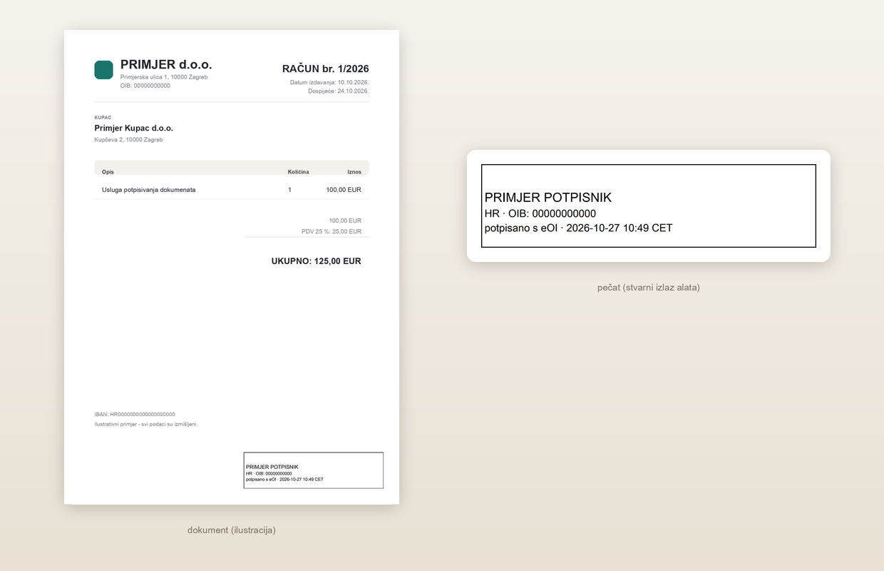

# Lokalno potpisivanje PDF-a (macOS · Linux · Windows)



Potpisivanje PDF dokumenata kvalificiranim certifikatom sa **smart kartice** preko PKCS#11
modula. Dokument i PIN **ne izlaze s računala** — nema clouda, nema uploada, nema posrednika.

> **Neslužbeni alat.** Nije povezan s AKD d.o.o. Radi preko AKD-ovog *Certilia Middleware*
> paketa, koji korisnik sam instalira; sam middleware se ne redistribuira i za njega vrijede
> AKD-ovi uvjeti.

- [Čemu služi](#čemu-služi)
- [Usporedba s Certilia](#usporedba-s-certilia-udaljeno-potpisivanje)
- [Zahtjevi](#zahtjevi)
- [Da li je sve spremno?](#da-li-je-sve-spremno)
- [Instalacija](#instalacija)
- [Brzi početak](#brzi-početak)
- [CLI opcije](#cli-opcije)
- [Kartica po operativnom sustavu](#kartica-po-operativnom-sustavu)
- [Vremenski žig i PAdES-LT](#vremenski-zig-i-pades-lt)
- [Provjera potpisa i popis potpisa](#provjera-potpisa-i-popis-potpisa)
- [Testovi](#testovi)
- [Poznata ograničenja](#poznata-ogranicenja)
- [Privatnost i PIN](#privatnost-i-pin)
- [Licenca](#licenca)

## Čemu služi

Bez ovog alata potpis PDF-a eOI karticom traži ili komercijalni servis (dokument prolazi kroz
njihov sustav) ili ručno petljanje s više programa. S ovim alatom, u jednoj naredbi (ili kroz GUI) dobiješ:

- PDF potpisan **kvalificiranim certifikatom s tvoje kartice** — ključ i PIN ostaju kod tebe;
- **vidljivi pečat** (ime, `država · OIB`, `potpisano s eOI · vrijeme`) — vektorski, oštar na
  svakom zoomu, ~2 KB;
- **vremenski žig** (RFC 3161) i, kad uvjeti dopuštaju, **PAdES-LT / LTA**;
- **provjeru** potpisa — i svojih i tuđih (uključujući starije bankovne `adbe.pkcs7.sha1`);
- sve to **offline** ako želiš (`--offline`) — nijedan bajt ne izlazi s računala;
- **dokument ne prolazi ni kroz kakav servis** — ni na potpis, ni na pohranu (kod udaljenog
  potpisivanja dokument se uploada servisu i briše odmah nakon potpisa, vidi usporedbu dolje).

**Kada NE koristiti:** s telefona, bez kartice/čitača, ili kad ti treba servis s podrškom i
arhivom — za to postoji Certilia (vidi dolje). Alat je neslužben, nije certificiran proizvod i
nije povezan s AKD-om; koristi njihov middleware koji sam instaliraš.

## Usporedba s Certilia (udaljeno potpisivanje)

Oba načina daju **istu razinu potpisa (QES)** — razlika je *gdje* potpis nastaje, *kome* treba
mreža, *tko* drži ključ i *prolazi li dokument kroz servis*.

| | **Ovaj alat** (lokalno) | **Certilia** (udaljeno) |
|---|---|---|
| Gdje nastaje potpis | na **tvojoj kartici**, u tvom računalu | u **AKD-ovom sustavu** (HSM) |
| Gdje je privatni ključ | **kod tebe** (kartica) | kod AKD-a |
| Što odobrava svaki potpis | **PIN na kartici** | autentikacija prema servisu |
| Što treba za rad | eOI kartica, čitač, AKD middleware | aktivacija/račun i internet; kartica ne mora biti u čitaču |
| Radi offline | **da** (`--offline`) | ne |
| Što servis dobije | **ništa** — potpis nastaje na kartici | dokument se uploada radi potpisa; potpisuje se **samo hash**, a dokument se **odmah po potpisivanju trajno briše** |
| Što ostaje kod njih | ništa (TSA-u ide samo hash, ako uključiš žig) | zapis o potpisu (broj zapisa + URL za provjeru), **ne dokument** |
| Vidljivi pečat | da, vektorski i prilagodljiv | da, njihov izgled |
| Vremenski žig / LTV | opcionalno (javni TSA ili AKD QTSA) | dio usluge |
| Cijena / licenca | besplatno, MIT | komercijalna usluga |
| Kad je bolje | privatnost, offline rad, često potpisivanje vlastitom karticom | nemaš karticu/čitač pri ruci, potpisuješ s telefona, ili želiš servis s podrškom |

> **Provjereno u AKD-ovim uvjetima** ([AKD ePotpis — Opći uvjeti](https://esign.certilia.com/media/ePotpis-opci-uvjeti.pdf),
> t. 4.6.2–4.6.3, provjereno 27.10.2026.): *„e-Usluga potpisuje samo sažetak (HASH) dokumenta…"*
> i *„e-Usluga ne čuva korisničke dokumente nakon potpisivanja, te ih odmah po potpisivanju trajno
> briše."* Dakle i kod udaljenog potpisivanja **dokument se ne pohranjuje** trajno — ali, za razliku
> od ovog alata, **prolazi kroz njihov servis** dok se ne potpiše.

> **Kvalificiranost potpisa ne dolazi od alata** — dolazi od certifikata i od toga što je ključ na
> QSCD-u (kartici). Alat je samo sučelje prema kartici; zato je razina ista kao kod Certilie.

## Zahtjevi

- **eOI kartica (eOsobna iskaznica)** s kvalificiranim certifikatom
  (eOI ima dva certifikata: **Signature** za potpisivanje i **Identification** za web-prijavu;
  alat nudi samo Signature jer Identification ne služi za potpis).
  Alat zna i **provjeriti** dokument koji je netko drugi potpisao udaljenim (cloud)
  certifikatom — npr. Certilia Ix — ali sam **nikad ne potpisuje udaljeno** i ne komunicira s
  tim servisom
- **AKD middleware** (paket *Certilia Middleware*, dolazi uz eOI karticu) instaliran za tvoj OS —
  daje PKCS#11 modul i CA certifikate
- **Python 3.10+**; za GUI i `tkinter`
- Čitač kartica (CCID) — radi i ugrađeni i USB čitač

## Da li je sve spremno?

Četiri naredbe, po redu — svaka kaže je li razina ispod spremna:

```bash
.venv/bin/python potpisi-pdf.py --list                  # 1) vidi li modul i karticu?  (token: AKD eID Card (Signature))
.venv/bin/python potpisi-pdf.py --check                 # 2) PIN OK, certifikat i ključ dohvaćeni (ne potpisuje)
.venv/bin/python potpisi-pdf.py --self-test             # 3) modul, CA, font, korijeni za TSA, preview
.venv/bin/python potpisi-pdf.py ugovor.pdf --offline    # 4) probni potpis bez ijednog mrežnog poziva
```

Kako čitati `--self-test`: `[OK ]` = radi, `[-- ]` = treba samo za karticu, `[WARN]` = radi ali
fali npr. font (pečat se tada ne crta).

**Trebaš:** eOI karticu s certifikatom *Signature* (ne *Identification*), čitač kartica (bilo koji
CCID — ugrađeni ili USB), AKD *Certilia Middleware* za tvoj OS (daje PKCS#11 modul i CA
certifikate) i Python 3.10+; za GUI još `tkinter`.

**Ne trebaš:** AKD-ov korisnički račun, internet (uz `--offline`), poseban čitač, nikakvu
registraciju ni slanje dokumenta ikome.

**Ako je nešto na drugom mjestu:** `--lib` / `--ca-dir` (ili `POTPIS_LIB` / `POTPIS_CA_DIR`).

## Instalacija

```bash
git clone <repo> && cd eOI-lokalni-potpis
python3 -m venv .venv
.venv/bin/pip install -r requirements.txt        # Windows: .venv\Scripts\pip
```

Dodatno, ovisno o OS-u:

| OS | Što još treba |
|---|---|
| **macOS** | `brew install python-tk@3.14` (samo za GUI) |
| **Linux** | `sudo apt install python3-tk fonts-dejavu-core` (GUI + font za pečat) |
| **Windows** | ništa dodatno (tkinter dolazi s python.org installerom) |

Font treba **samo za vidljivi pečat**; bez njega se pečat **ne crta** (potpis je ispravan, ali je
nevidljiv).

## Brzi početak

GUI:

```bash
./run.sh                     # macOS/Linux
run.bat                      # Windows
```

ili dvoklik na `potpisi-gui.command` (macOS). U GUI-ju: odaberi PDF → klikni okvir u koji ide
pečat (ili povuci mišem) → upiši PIN → **Potpiši PDF**. Desno vidiš popis potpisa i tijek rada.

CLI:

```bash
.venv/bin/python potpisi-pdf.py --check                # proba PIN-a i ključa, ne potpisuje
.venv/bin/python potpisi-pdf.py ugovor.pdf             # nevidljiv potpis -> ugovor-signed.pdf
.venv/bin/python potpisi-pdf.py --visible ugovor.pdf
.venv/bin/python potpisi-pdf.py --verify ugovor-signed.pdf
.venv/bin/python potpisi-pdf.py --self-test            # provjera platforme (bez kartice)
```

### Što piše u vidljivom pečatu

Pečat je **vektorski PDF tekst** (isti izgled u svim preglednicima) i sadrži, po veličini:

1. **ime i prezime** potpisnika (CN) — najveće,
2. **država · OIB** (OIB se čita iz serijskog broja certifikata, npr. `PNOHR-00000000000`),
3. **`potpisano s eOI · <vrijeme>`** — manje od CN linije, vrijeme je u istom redu
   (za certifikate koji nisu eOI piše `potpisano lokalno`).

Engleska varijanta sučelja: [primjer/potpis-primjer-en.png](primjer/potpis-primjer-en.png) ·
uvećani pečat: [primjer/potpis-primjer-zoom.png](primjer/potpis-primjer-zoom.png).
Sintetički dokument za testiranje: [primjer/primjer-racun.pdf](primjer/primjer-racun.pdf).

Snimke se generiraju **iz koda** (pa ne mogu odstupiti od njega):

```bash
.venv/bin/python primjer/napravi-snimke.py    # potpise demo dokument i izveze preglede HR/EN + zoom
```

Ako nema upotrebljivog sistemskog fonta, pečat se **ne crta** (potpis je tada nevidljiv) —
na Linuxu instaliraj `fonts-dejavu-core`.

Pečat je **vektorski** — pravi PDF tekst s ugrađenim podskupom fonta (ime većim slovima, detalji
manjim), pa je oštar na svakom zoomu i mali (~2 KB).

> Napomena za programere: da bi to radilo, alat lokalno krpa bug u pyHanku 0.37 — on piše širine
> CID glifova (`/W`) u *font units* umjesto u tisućinke em, zbog čega preglednici razmaknu slova
> (`P R I M J E R`). Popravak je u `_patch_pyhanko_font_widths()`.

Pečat ne sadrži razlog ni mjesto — niti ih alat uopće upisuje u PDF (potpis ima samo standardna
polja: `ByteRange`, `Contents`, `Filter`, `M`, `SubFilter`, `Type`). Time se u dokument ne
"procuri" nikakva dodatna informacija (npr. svrha putnog naloga).

## CLI opcije

**Obavezno je samo putanja do PDF-a.** Sve ostalo je opcionalno i ima zadanu vrijednost.

| Način rada | Kako se uključuje | Obavezni argument |
|---|---|---|
| Potpisivanje (zadano) | bez ijednog „mod” flaga | `<PDF>` |
| Validacija potpisa | `--verify` | `<PDF>` |
| Popis tokena na kartici | `--list` (uz `--login` traži PIN) | — |
| Proba PIN-a i ključa (bez potpisa) | `--check` | — |
| Provjera platforme (bez kartice) | `--self-test` | — |

### Tablica svih opcija

| Opcija | Nužno | Default | Što radi |
|---|---|---|---|
| `<PDF>` | **da** | — | ulazni PDF (kod `--verify`: potpisani PDF) |
| `-h`, `--help` | ne | — | ispiše pomoć |
| `--version` | ne | — | ispiše verziju |
| `--self-test` | ne | isključeno | provjera platforme softverskim certifikatom (bez kartice) |
| `--lib PUTANJA` | ne | autodetekcija po OS-u (env `POTPIS_LIB`) | putanja do PKCS#11 modula |
| `--ca-dir MAPA` | ne | autodetekcija (env `POTPIS_CA_DIR`) | mapa s AKD CA certifikatima (PEM/DER) |
| `--list` | ne | isključeno | popiši tokene/certifikate/ključeve |
| `--login` | ne | isključeno | s `--list`: prijavi se PIN-om (ispiše i privatne ključeve) |
| `--check` | ne | isključeno | proba PIN i dohvat ključa, **ne potpisuje** |
| `--verify` | ne | isključeno | samo validiraj potpise u PDF-u |
| `--token DIO` | ne | `Signature` | dio naziva tokena (`Identification` je za web-prijavu) |
| `--cert-id HEX` | ne | auto (jedini potpisni certifikat) | ID certifikata na kartici |
| `--key-id HEX` | ne | auto | ID privatnog ključa |
| `--key-label NAZIV` | ne | auto | naziv privatnog ključa |
| `--field NAZIV` | ne | prvo slobodno (`Signature1`, `Signature2`, …) | naziv potpisnog polja |
| `--ku LISTA` | ne | `non_repudiation` | key usage potpisnika |
| `--visible` / `--no-visible` | ne | **da** (vidljiv pečat) | vidljivi pečat na stranici |
| `--page N` | ne | `1` | stranica za vidljivi pečat |
| `--box "x1,y1,x2,y2"` | ne | **auto**: donji desni kut, 248×64 pt (28 pt od ruba) | okvir pečata u točkama |
| `--font PUTANJA` | ne | prvi sistemski (Arial Unicode / DejaVu / Arial) | TrueType font pečata |
| `--font-size N` | ne | `10` | najveća veličina teksta pečata (pt) |
| `--tsa URL` | ne | `digicert` (javni TSA) | RFC 3161 vremenski žig; `none` ga isključuje |
| `--no-tsa` | ne | — | potpis bez vremenskog žiga |
| `--offline` | ne | isključeno | **nijedan mrežni poziv** (bez žiga, LT/LTA i dohvata); env `POTPIS_OFFLINE=1` |
| `--lt` / `--no-lt` | ne | **uključeno** | PAdES-LT: ugradi dokaze o opozivu (OCSP/CRL) |
| `--lta` / `--no-lta` | ne | **da** | PAdES-LTA: nakon potpisa doda **dokument-timestamp** (traži žig) |
| `--tsa-auth KORISNIK:LOZINKA` | ne | prazno (env `TSA_AUTH`) | HTTP basic auth za TSA (npr. AKD QTSA) |
| `--trust PEM` | ne | `AKDCARoot.pem` iz `--ca-dir` | korijenski certifikat za validaciju |
| `--out PUTANJA` | ne | `<ulaz>-signed.pdf` | izlazni PDF |
| `--no-verify` | ne | isključeno (validira odmah nakon potpisa) | ne validiraj odmah nakon potpisa |

GUI prima: `<PDF>`, `--lang hr|en` (default `hr`), `--lib`, `--ca-dir`, `--screenshot PNG`, `-h`.

PIN se može dati i kroz env `POTPIS_PIN` (GUI to koristi za maskirano polje).

### Tipične kombinacije

```bash
# 1) najkraće: nevidljiv potpis, javni vremenski žig, LT ako ima podataka
.venv/bin/python potpisi-pdf.py ugovor.pdf

# 2) vidljiv pečat u okviru koji već znaš
.venv/bin/python potpisi-pdf.py --visible --box "60,600,420,700" ugovor.pdf

# 3) bez vremenskog žiga, bez LT i bez vidljivog pečata (npr. nema mreže)
.venv/bin/python potpisi-pdf.py --no-tsa --no-lt --no-lta --no-visible ugovor.pdf

# 4) potpuno offline (nijedan mrežni poziv) - npr. osjetljivi dokumenti
.venv/bin/python potpisi-pdf.py --offline ugovor.pdf

# 5) validacija i popis
.venv/bin/python potpisi-pdf.py --verify ugovor-signed.pdf
.venv/bin/python potpisi-pdf.py --list
```

## Kartica po operativnom sustavu

Alat sam pronalazi modul i certifikate; ako su na drugom mjestu, koristi `--lib` / `--ca-dir`.

| OS | PKCS#11 modul (autodetekcija) | AKD CA certifikati |
|---|---|---|
| macOS | `/Applications/CertiliaMiddleware.app/Contents/pkcs11/libCertiliaPkcs11.dylib` | `…/Contents/certificates` |
| Linux | `/opt/certiliamiddleware/pkcs11/libCertiliaPkcs11.so` | `/opt/certiliamiddleware/certificates` |
| Windows | `C:\Program Files\AKD\Certilia Middleware\pkcs11\CertiliaPkcs11_64.dll` | `…\Certilia Middleware\certificates` |

Provjera redom: `--list` (vidi li modul i karticu) → `--check` (PIN i ključ) → potpis →
`--verify` → otvori PDF u svom pregledniku.

## Vremenski žig i PAdES-LT

- **Vremenski žig (RFC 3161)** je po defaultu uključen i koristi javni DigiCert TSA — daje
  neovisni dokaz *kada* je potpis nastao (za razliku od vremena iz računala potpisnika).
  Isključi ga s `--no-tsa`, ili koristi svoj/qualified TSA: `--tsa URL --tsa-auth user:pass`
  (npr. **AKD QTSA**, aktivacija preko Certilia Developer).
- **Dokument-timestamp (PAdES-LTA)** je po defaultu uključen (`--no-lta` ga isključuje): nakon
  potpisa alat doda zaseban `/DocTimeStamp` objekt, isto kao Certilia Signer. Za razliku od
  potpisnog žiga, dokument-timestamp pokriva **cijeli dokument** i vrijedi i za eOI certifikate.
- **PAdES-LT** ugrađuje dokaze o opozivu. Certifikati s eOI kartice ne objavljuju CRL/OCSP
  adrese, pa se LT automatski preskoči (nema što ugraditi) — očekivano, potpis je i dalje valjan.
- Ako žig ili LT ne prođu (npr. nema mreže), alat **ne pada**: ispiše upozorenje i potpiše
  skromnijom varijantom (`LT+žig → LT → osnovni+žig → osnovni`). Izlaz se piše u `.part` i tek
  na uspjeh preimenuje, pa nikad ne ostane polovičan PDF.

## Što ide na mrežu (i što ne)

| Radnja | Mrežni promet |
|---|---|
| Potpisivanje karticom | **ništa** — potpis nastaje lokalno na kartici |
| Vremenski žig / dokument-timestamp | TSA-u se šalje **samo hash** (nikad dokument); isključi s `--no-tsa --no-lta` |
| Validacija potpisa | može dohvatiti CA certifikate/OCSP radi provjere lanca (nikad dokument) |
| Sve ostalo | ništa — nema telemetrije, nema clouda, nema posrednika |

Ako želiš **garanciju da nijedan bajt ne izađe**, koristi `--offline` (ili `POTPIS_OFFLINE=1`):
tada alat ne radi nijedan mrežni poziv — isključeni su žig, dokument-timestamp, PAdES-LT i
dohvat OCSP/AIA. Potpis je i dalje valjan i provjerljiv lokalno.

```bash
.venv/bin/python potpisi-pdf.py --offline ugovor.pdf
```

## Provjera potpisa i popis potpisa

```bash
.venv/bin/python potpisi-pdf.py --verify dokument.pdf
```

Ispiše potpisnika, izdavatelja, `intact/valid/trusted`, algoritam, pokrivenost dokumenta, vrijeme
potpisa te ima li vremenski žig (i je li žig *trusted*).

**Stariji potpisi (npr. `adbe.pkcs7.sha1`)** — tipični za starije bankovne/izdavateljske dokumente —
provjeravaju se posebnom, lokalnom provjerom: u tom profilu CMS sadrži **SHA-1 digest dokumenta**, a
potpis je nad tim digestom, pa se provjeri (a) poklapa li se digest s dokumentom i (b) je li potpis
ispravan, uz lanac iz certifikata u PDF-u i **lokalnih** korijena (bez mreže). Rezultat se prikaže
s napomenom `[stari SHA-1 profil (bez žiga)]` i upozorenjem da **vrijeme potpisa nije kriptografski
zaštićeno**; ako dokument ima izmjena nakon potpisa, to se također prijavi. U GUI-ju se **popis potpisa** ispisuje
automatski pri otvaranju dokumenta (polje, potpisnik, vrijeme, valjan/pouzdan, žig) i kaže u koje
polje ide sljedeći potpis.

## Testovi

```bash
.venv/bin/pip install pytest
.venv/bin/python -m pytest -q tests/
```

Testovi bez kartice (prijevodi, parser, ispis, pomoćne funkcije, offline način, integracijski
potpis softverskim certifikatom). CI (`.github/workflows/selftest.yml`) ih vrti na **Ubuntu, Windows i
macOS** za Python 3.11–3.13, plus `--self-test`.

## Poznata ograničenja

- **Kartica na Linuxu/Windowsima nije potvrđena na stvarnom stroju.** Softverski sloj je provjeren
  (Linux u kontejneru: potpis i validacija rade; Windows: instalater sadrži PKCS#11 DLL i staze su
  podržane), ali pravi test s karticom treba odraditi na tom OS-u (`--list`, `--check`).
- Kvalificiranost potpisa dolazi od **certifikata i QSCD-a**, ne od alata — alat je samo sučelje.
- Stari `adbe.pkcs7.sha1` potpisi se provjere kriptografski (SHA-1 digest + potpis), ali to je
  **slab profil**: SHA-1, bez signed attributes i bez vremenskog žiga, pa vrijeme potpisa nije
  zaštićeno. Za PAdES/eIDAS razinu potreban je SHA-256+ i vremenski žig.
- CLI `--help` je na hrvatskom (GUI je dvojezičan).
- Nema `.app`/`.exe` pakiranja — pokreće se iz checkouta (vidi [Brzi početak](#brzi-pocetak)).

## Privatnost i PIN

- Dokument, PIN i privatni ključ **ne napuštaju računalo**; potpis se stvara na kartici, lokalno.
  Alat ne šalje nikakve podatke — osim ako je uključen vremenski žig, kada TSA-u ide samo *hash*
  potpisa (nikad dokument). Za potpunu garanciju: `--offline`.
- PIN se unosi maskirano u GUI-ju ili interaktivno u CLI-ju. Ako ga daješ kroz env (`POTPIS_PIN`)
  ili `--tsa-auth`, imaj na umu da su env/argv vidljivi procesima istog korisnika.
- **Pazi na broj pokušaja PIN-a**: kartica obično dopušta 3 promašaja, nakon čega treba PUK.

## Licenca

[MIT](LICENSE) · ovisnosti i njihove licence: [THIRD-PARTY.md](THIRD-PARTY.md) · promjene:
[CHANGELOG.md](CHANGELOG.md)

## Raspored

```
potpisi-pdf.py    CLI + sva logika potpisivanja/validacije
potpisi-gui.py    Tk GUI (preview, mreža okvira, teme, HR/EN)
tests/            testovi bez kartice (pytest)
primjer/          sintetički demo dokument i snimke (bez stvarnih podataka)
.github/          CI matrica (ubuntu/windows/macos)
run.sh, run.bat   pokretači za GUI
```
